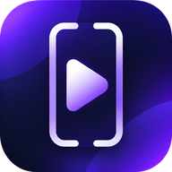
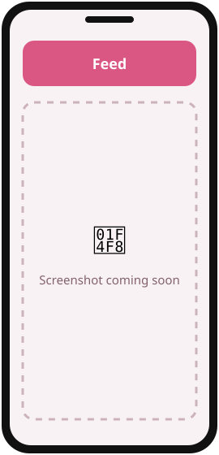
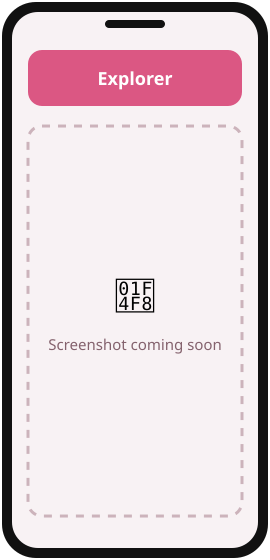
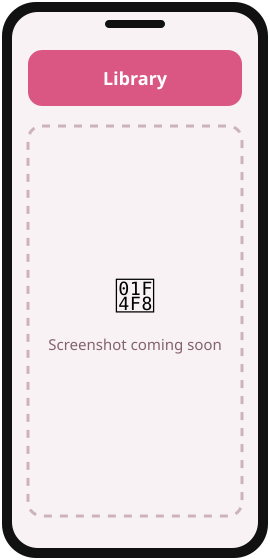

<div align="center">



# vidéoFlows

**Your own videos in a vertical swipe feed — an offline video player for Android.**

  

[](https://github.com/Iurika-N-T-R/videoFlows/releases/latest)
[](https://github.com/Iurika-N-T-R/videoFlows/releases)
[](LICENSE)
[](https://github.com/Iurika-N-T-R/videoFlows/stargazers)

[**⬇️ Download**](#download) · [**📸 Screenshots**](#screenshots) · [**✨ Features**](#features) · [**🛠️ Build**](#build)

</div>

---

<a id="screenshots"></a>

## 📸 Screenshots

<!-- TODO: replace docs/assets/screenshot-N.svg with real screenshots (same size for all, e.g. 1080x2400) -->
<div align="center">
<table>
  <tr>
    <td align="center"><br><sub><b>Feed</b></sub></td>
    <td align="center"><br><sub><b>Explorer</b></sub></td>
    <td align="center"><br><sub><b>Library</b></sub></td>
  </tr>
</table>
</div>

---

## 💡 What is vidéoFlows?

vidéoFlows helps **people with big local video collections** rediscover them **in a vertical swipe feed**,
like short-video apps — but with your own files, without an account, an algorithm or the internet.
It is free, open source, works offline and contains no ads or trackers. Playback is powered by libVLC, so it reads almost every format.

> vidéoFlows is an independent app written from scratch. It is not affiliated with any short-video platform, nor with VideoLAN.

### 👥 Who is it for?

- 🎬 **Collectors** of clips, references, tutorials and recordings scattered across folders
- 🎨 **Artists & animators** browsing video references and pinning notes to timestamps
- 🔒 **Offline people** who want a feed without an account or recommendations

---

<a id="features"></a>

## ✨ Features

| | Feature | Description |
|:-:|---|---|
| 📱 | **Swipe feed** | Up for next, down for previous, double-tap to favorite |
| 🔀 | **Play orders** | Smart mix (unseen first), random, unseen only, newest, oldest, A→Z |
| 📝 | **Notes & tags** | Notes pinned to a timestamp, your tags + automatic ratio / resolution tags |
| 🔎 | **Search** | Live search on title, folder, tags and notes — play the results as a feed |
| 🗂️ | **Explorer** | Unseen, short, with notes, favorites, every folder, every tag |
| ⏯️ | **Resume** | Pick up the last video where you left it; history by day |
| 🎞️ | **libVLC inside** | Plays almost any codec and container |
| 🔒 | **Private by design** | Your data stays on your device; export it as JSON |

<details>
<summary><b>📖 Full guide — every screen and option</b></summary>

Swipe **up** for the next video, **down** for the previous one. Tap to pause, **double-tap** to add to favorites, drag the bar at the bottom to seek.

**Top bar**
- **Play order** (left): smart mix (unseen first, then least recently watched), random, unseen only, newest, oldest, name A→Z.
- **Pour toi / Favoris**: everything, or only your favorites.
- **Search** (right): live results on title, folder, tags and notes; play all the results as a feed. The pill under the bar shows the active filter; ✕ clears it.
- At launch, a card offers to **resume** the last video where you left it.

**On each video**
- **Folder** (round button or folder chip): play only this folder.
- **♥**: favorite. **Notes**: notes pinned to the current time; tap a timestamp to jump back to it. **Tags**: your tags plus automatic ones (ratio 9:16, 16:9…, resolution 4K, 1080p, 720p, SD).
- **Infos**: resolution, frame rate, codec, duration, size, date; play the whole folder, restart, or hide the video from the feed.
- **▶ 1×** pill: playback speed (1×, 1.5×, 2×, 0.5×). Speaker: mute.

**Bottom bar**
- **Explorer**: unseen, short (≤30 s), with notes, favorites; every folder; every tag (or combine several).
- **+**: add a folder to scan (subfolders included).
- **Récents**: what you watched, by day, with resume.
- **Biblio**: stats; folders (switch one off to leave it out of the feed, trash to remove it, ignore a subfolder); hidden videos; playback settings (order at launch, autoplay next, loop, remember position, start muted); rescan; export favorites, tags and notes as JSON.

</details>

---

<a id="download"></a>

## ⬇️ Download

<div align="center">

<a href="https://github.com/Iurika-N-T-R/iurikaFlows/releases/latest">
  
</a>
&nbsp;
<a href="https://github.com/Iurika-N-T-R/videoFlows/releases/latest">
  
</a>

</div>

### 🟢 Recommended: with iurikaFlows (automatic updates)

1. Install **iurikaFlows** → [download here](https://github.com/Iurika-N-T-R/iurikaFlows/releases/latest).
2. Open it and find **vidéoFlows** in *Découvrir*.
3. Tap **Install**. Future updates arrive automatically. ✅

### 🔵 Manual install (APK)

1. Go to the [**latest release**](https://github.com/Iurika-N-T-R/videoFlows/releases/latest).
2. Under **Assets**, download the file ending in **`.apk`**.
3. Open it on your phone. If Android asks, allow **"Install unknown apps"** for your browser/file manager.
4. Tap **Install**. Done! 🎉

<details>
<summary><b>❓ Why isn't it on the Play Store?</b></summary>
<br>
vidéoFlows is an independent, free project. Instead of the Play Store, it is distributed through
GitHub Releases and <b>iurikaFlows</b>, a small open-source store that keeps all my apps up to date.
The APKs are built from this public source code — you can check everything.
</details>

<details>
<summary><b>🛡️ Is it safe? Android says "unknown source"</b></summary>
<br>
This warning appears for every app installed outside the Play Store. The code is 100% public in this repository,
and each release is signed with the same key, so Android will refuse any modified version.
</details>

> **Requirements:** Android 7.0+ on a 64-bit device · ~115 MB (libVLC included)

---

<a id="build"></a>

## 🛠️ Build from source

<details>
<summary><b>For developers — click to expand</b></summary>

**Prerequisites:** [Android Studio](https://developer.android.com/studio) (latest) or the Android SDK (platform 36) · JDK 17–21

```bash
git clone https://github.com/Iurika-N-T-R/videoFlows.git
cd videoFlows
./gradlew assembleDebug
```

The APK is generated in `app/build/outputs/apk/debug/`.

**Signed release:** `./gradlew assembleRelease` signs the APK only if a git-ignored `keystore.properties`
(`storeFile`, `storePassword`, `keyAlias`, `keyPassword`) sits at the project root; otherwise it comes out unsigned.

</details>

---

## 🤝 Contributing

Ideas, bugs, translations — all contributions are welcome!

- 🐛 **Found a bug?** → [Open an issue](https://github.com/Iurika-N-T-R/videoFlows/issues/new)
- 💡 **Have an idea?** → [Open an issue](https://github.com/Iurika-N-T-R/videoFlows/issues) and describe it
- ⭐ **Like it?** → A star on this repo helps other people find it!
- ☕ **Want to support the work?** → [Buy me a coffee](https://buymeacoffee.com/iurika)

---

## 🧩 More apps by Iurika-N-T-R

<!-- Same block in EVERY repo: cross-linking boosts visibility of all the projects -->
| App | Description |
|---|---|
| [**iurikaFlows**](https://github.com/Iurika-N-T-R/iurikaFlows) | My open-source app store — installs and updates all my apps |
| [**DroRef**](https://github.com/Iurika-N-T-R/DroRef) | Reference board for artists, opens and saves PureRef `.pur` files |
| [**OnlyFlows**](https://github.com/Iurika-N-T-R/OnlyFlows) | Offline-first task & project manager with LAN sync |
| [**ColorFlows**](https://github.com/Iurika-N-T-R/ColorFlows) | Color harmonies, palettes from pictures, painter's shading sphere |
| [**galleryFlows**](https://github.com/Iurika-N-T-R/galleryFlows) | Gallery that browses your real folder tree |
| [**RandomFlows**](https://github.com/Iurika-N-T-R/RandomFlows) | Randomizer & decision maker on your own lists |
| [**Brush Converter**](https://github.com/Iurika-N-T-R/ABR-to-PRZP-Brush-converter) | Photoshop `.abr` brushes → Infinite Painter `.przp`, in the browser |

---

### 🙏 Credits

Video playback uses [libVLC](https://code.videolan.org/videolan/vlc-android), licensed under the LGPL 2.1+;
see [third_party/LIBVLC_NOTICE.txt](third_party/LIBVLC_NOTICE.txt).

---

<div align="center">

📄 Released under the **[MIT License](LICENSE)** · libVLC under LGPL 2.1+

Made with ❤️ by [**Iurika-N-T-R**](https://github.com/Iurika-N-T-R)

<sub>If vidéoFlows is useful to you, consider giving it a ⭐ — it really helps!</sub>

</div>
